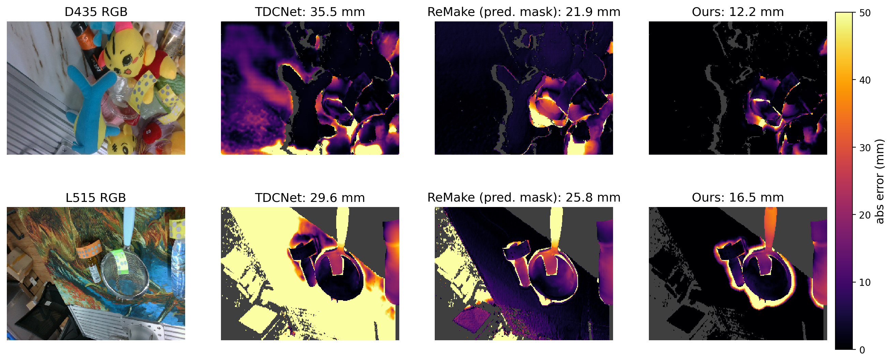
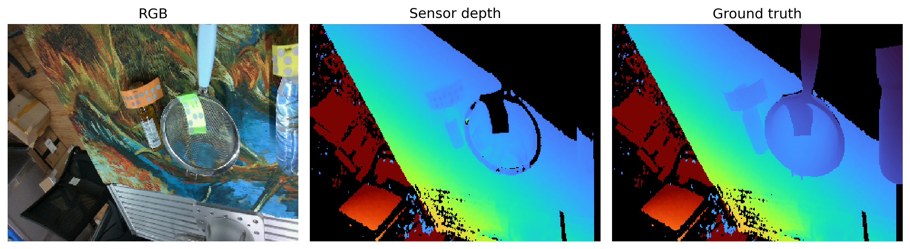
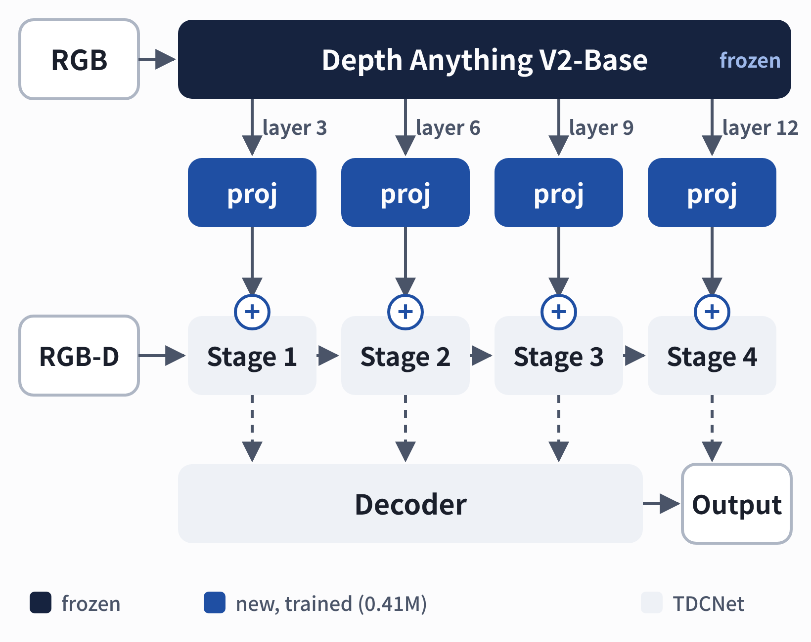
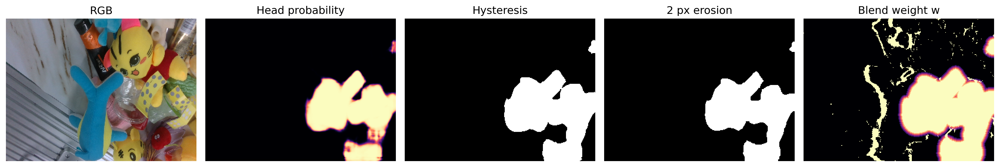
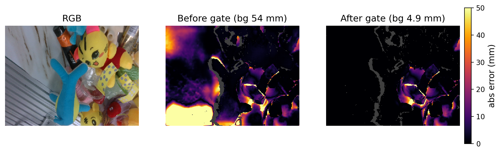
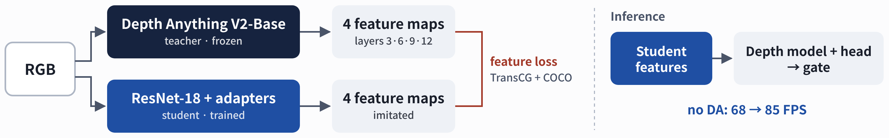
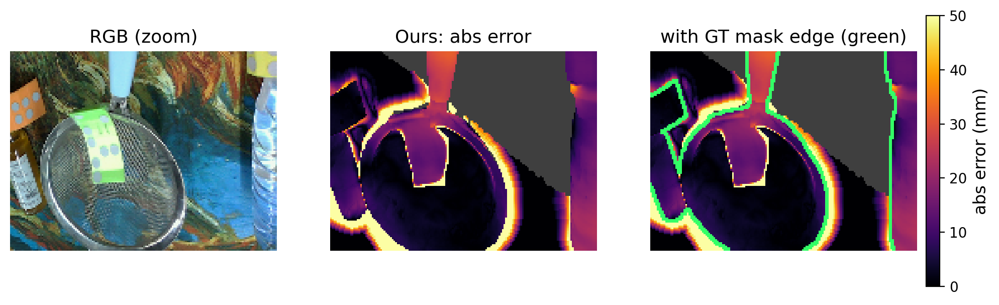
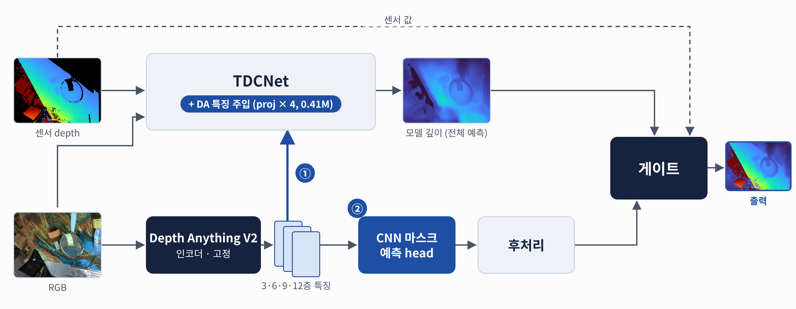
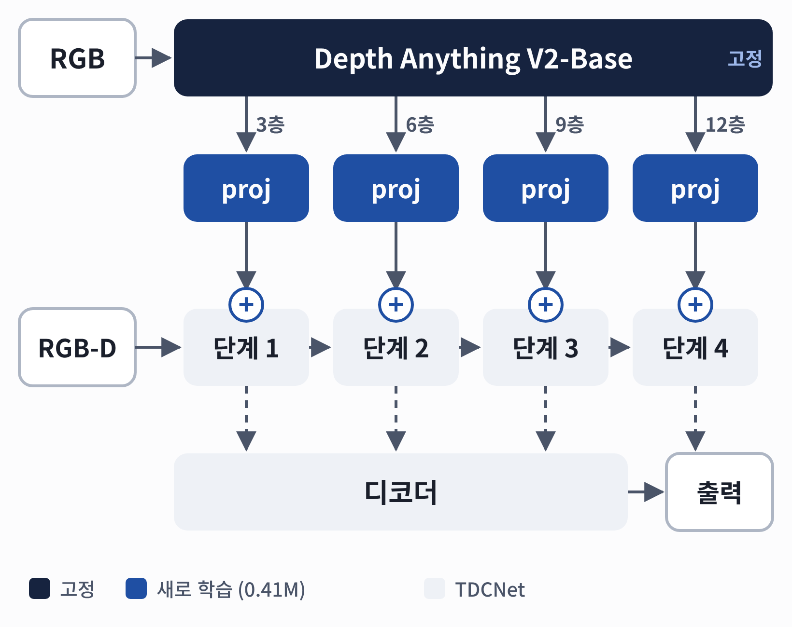
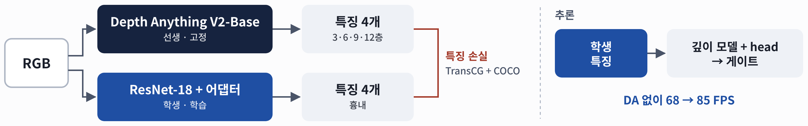

<div align="center">

# Real-time Transparent Depth Completion without a Ground-Truth Mask

**[English](#english) · [한국어](#korean)**



</div>

<a id="english"></a>

# English

## 1. Abstract



Commodity RGB-D cameras lose depth on transparent objects or measure it wrong. Grasping and 3D reconstruction need
that depth, so the missing parts must be filled from the RGB image and the remaining sensor depth. This task is called
depth completion. Recent state-of-the-art models have the following strengths and limitations:

| | Strength | Limitation |
|---|---|---|
| TDCNet [5] | CNN + Transformer fusion; fast; no mask needed | re-predicts the whole depth map: 282 mm error on opaque background |
| ReMake [6] | accurate, thanks to the Depth Anything [7] prior | needs the transparent mask as input (in practice another model, e.g. SAM, must produce it); sensitive to mask errors (11.4 → 15.8 mm with a predicted mask); 18 FPS at 640×480 |

The improved model combines the strengths of both:
* **Feature injection:** unlike ReMake, which uses Depth Anything's final output (a single depth channel), we inject
  the hidden-layer features of its encoder directly. They carry more information than one depth channel, and skipping
  the decoder saves its cost. Small projection layers (0.41M) reshape them to match TDCNet's encoder features, to which
  they are added; zero initialization keeps training stable.
* **Mask head + gate:** a lightweight mask head on the same Depth Anything features predicts the transparent region,
  and this mask builds a gate. The model's estimate is used in the transparent region and the sensor value elsewhere,
  with a smooth distance-based blend at the boundary.

**Results**
* **TransCG:** transparent-region RMSE of **10.48 mm (66 FPS)**, or **10.14 mm (31 FPS)** in the accuracy-oriented mode.
  * Better than ReMake given the ground-truth mask (11.37 mm).
  * Opaque-background error drops from 282 mm (TDCNet) to **1.4 mm** (−99.5%). The gate also works on other models.
* **Generalization:** trained on TransCG and tested on ClearGrasp, label-free adaptation with 173 unlabelled images
  reaches **17.9 mm**. This is the lowest value in the comparison, but the models adapt different parts, so it is
  not a like-for-like comparison.
* **Distillation:** distilling Depth Anything into a ResNet-18 removes it at inference; the model then runs at 85 FPS.

## 2. Method


### 2.1 Depth Anything feature injection

TDCNet fuses its Transformer-branch (RGB-D) and CNN-branch (depth) features at four resolutions before decoding. At
each fusion, we additionally add Depth Anything features:

1. The Depth Anything V2-Base encoder runs once per frame at 252x336.
2. Its layer-3, 6, 9 and 12 features (768 channels, 18x24 resolution) each pass through a projection: a 1x1 conv down
   to 64 channels, GroupNorm, GELU, then a 3x3 conv to the channel count of that stage.
3. The result is upsampled and added to the matching stage.

Training follows TDCNet's official recipe, from scratch.



ReMake uses Depth Anything's final result (a relative depth map); we use its intermediate features. They are richer
than a single depth channel, and skipping the decoder is faster.

### 2.2 Mask head and gate

The **mask head** predicts where the transparent objects are, with no ground-truth mask at inference:
* each of the four Depth Anything feature maps is reduced to 32 channels and upsampled to 320x240;
* these are concatenated with RGB, the sensor depth and a depth-valid flag;
* four dilated 3x3 conv blocks follow (dilation 1, 2, 4, 1).

After training, its IoU with the ground-truth mask is 0.84.

The **gate** turns the head's probability into per-pixel blend weights:
1. Hysteresis thresholding: start where p > 0.5 and grow into p > 0.1. Faint parts survive if they are attached to a
   confident part.
2. The mask is eroded by 2 px to drop uncertain edge pixels.
3. Distance blend: the model weight is 1 inside the mask and falls linearly to 0 between 4 and 12 px outside it, so no
   seam appears.
4. Pixels without a sensor value always take the model output.



<sub>Error before and after the gate on a D435 scene: background 54 mm → 4.9 mm.</sub>

The head and gate are not tied to a specific model and can be used with other models (Sec. 3.1).

### 2.3 Two modes

* **Fast:** one Depth Anything pass is shared by the depth model and the head.
* **Accurate:**
  * the head gets a second Depth Anything pass at 378x504. The feature resolution becomes 27x36 (1.5x), which gives
    finer object outlines;
  * the depth model uses left-right test-time augmentation (TTA).

### 2.4 Distillation



A ResNet-18 with small adapters learns to imitate the four feature maps. The parameter count drops from 86.6M (Depth
Anything encoder) to 17.6M.

### 2.5 Label-free adaptation

A new domain has no depth or mask labels, so we train for 600 more steps (about 5 minutes) on its RGB-D images alone,
with three losses:
1. **Trust the sensor:** the sensor measures opaque surfaces well, so outside the predicted mask (dilated by 6 px) the
   sensor value is used as the target.
2. **Flip consistency:** in the transparent region, where the sensor cannot be trusted, the prediction must stay the
   same under a left-right flip.
3. **Keep the original skill:** TransCG batches are mixed in so the original accuracy is not forgotten.

To avoid overfitting, only the 0.41M injection projections are trained.

## 3. Experiments

**Setup**
* **Data:** TransCG [1] at 320x240; the test set has 23,524 images (D435 / L515). ClearGrasp [2] real images: 173 val
  images (used only for adaptation) and 113 test images.
* **Comparison:** every method was re-run from its official checkpoint on the same data, with the same metrics, on the
  same GPU (NVIDIA L4).
* **Metrics:** computed per image, then averaged.
  * RMSE (mm) and δ1.05 (%) inside the ground-truth transparent mask
  * region errors around the mask: boundary (±3 px), surround (3–15 px outside), background (> 15 px)
* **Speed:** every method at batch 1, fp16 + CUDA graphs.

### 3.1 Comparison (TransCG test, all 23,524 images)

| Method | GT mask | RMSE (mm) ↓ | δ1.05 (%) ↑ | Boundary (mm) ↓ | Background (mm) ↓ | FPS ↑ |
|---|:-:|--:|--:|--:|--:|--:|
| FDCT [4] | no | 15.80 | 88.05 | 25.9 | 16.8 | 393 |
| TODE-Trans [3] | no | 13.46 | 90.43 | 29.1 | 20.9 | 206 |
| TDCNet [5] (official recipe, reproduced) | no | 11.93 | 92.42 | 29.0 | 282 | 177 |
| ReMake [6] | **yes** | 11.37 | 93.17 | **9.7** | 4.4 | 18\* |
| **Ours – fast** | no | 10.48 | 94.46 | 27.3 | 1.4 | **66** |
| **Ours – accurate** | no | **10.14** | **94.70** | 27.0 | **1.1** | 31 |

Speed: NVIDIA L4, batch 1, fp16 + CUDA graphs. Boundary: ±3 px around the mask edge; background: > 15 px outside.
\* ReMake at its official 640×480 input, mask generation not included (in practice a model such as SAM must produce
the mask).

* **Reproduction check:** the re-measured baselines match their papers (TDCNet 12, TODE 13, FDCT 15 mm).
* **ReMake's mask dependence:** given our predicted mask instead of the ground truth, ReMake drops to 15.76 mm
  (+39%); ours moves only from 10.28 (GT mask) to 10.48 mm (+2%).
* **ReMake at our resolution:** its checkpoint is trained at 640×480. At 320×240 without retraining it reaches
  23.6 mm (test subset, 2,381 images). On one GPU (T4) at 320×240, ours runs at 29.8 FPS and ReMake at 16.4 FPS, or
  36.3 FPS with a smaller Depth Anything input (same 23.6 mm).
* **Gate on other models:** it also works elsewhere. Background error falls from 16.90 to 1.09 mm for FDCT, and from
  4.57 to 0.78 mm for ReMake with a predicted mask.

### 3.2 Incremental ablation (TransCG test, all 23,524 images)

| Step | Transparent (mm) ↓ | δ1.05 (%) ↑ | Boundary (mm) ↓ | Background (mm) ↓ | Mask IoU | FPS |
|---|--:|--:|--:|--:|--:|--:|
| TDCNet | 11.93 | 92.42 | 29.0 | 281.7 | – | 182 |
| + DA feature injection | 10.23 (−14.2%) | 94.59 | 28.3 | 275.1 (−2.4%) | – | 99 |
| + mask head + gate | 10.48 (+2.4%) | 94.46 | 27.3 | 1.43 (−99.5%) | 0.842 | 69 |
| + high-res head | 10.37 (−1.0%) | 94.52 | 27.3 | 1.08 (−24.5%) | 0.860 | 45 |
| + flip TTA | 10.14 (−2.2%) | 94.70 | 27.0 | 1.07 (−0.9%) | 0.860 | 31 |
| *reference: GT mask instead of the head (no TTA)* | *10.28* | *94.57* | – | *0.00* | – | – |

* **Feature injection** improves the transparent region.
  * Retraining with another seed gives almost the same result (10.22 mm).
  * Training it jointly from scratch beats adding it to a frozen TDCNet (11.74 mm).
* **The gate** removes the background error at a cost of about 0.25 mm inside the mask.
* **The high-res head** gives a better mask (IoU 0.842 → 0.860) and lowers the background error further.
* **Head size:** a head on Depth Anything V2-Small features is worse than one on V2-Base.

**Mask post-processing** (region errors, mm)

| Mask processing | Transparent | Boundary | Background |
|---|--:|--:|--:|
| *no mask (model output everywhere)* | *10.23* | *28.32* | *275.07* |
| head probability as blend weight (w = p) | 12.60 | 20.65 | 0.55 |
| hysteresis 0.5 / 0.1, hard 0/1 switch | 11.69 | 24.13 | 0.90 |
| + distance blend 4–12 px | 10.35 | 28.11 | 2.28 |
| **+ 2 px erosion (final)** | 10.48 | 27.35 | 1.43 |
| + flip TTA | 10.24 | 27.02 | 1.42 |

Using the head probability directly as the blend weight keeps the background clean but costs 2.1 mm in the transparent
region, because the probability stays below 1 inside many objects; rescaling it (e.g. 0.05–0.3 → 0–1) still gives
11.8–12.9 mm. Thresholding plus a distance blend keeps the transparent error close to the no-mask model.

### 3.3 Generalization: TransCG → ClearGrasp real-test (113 images)

| Method | No adaptation | 5 images | 173 images |
|---|--:|--:|--:|
| FDCT | 24.9 | 24.6 | 27.8 |
| ReMake (GT mask) | 27.0 | **18.3** | 19.2 |
| TODE-Trans | 32.7 | 22.5 | 27.5 |
| ReMake (predicted mask) | 37.4 | 25.9 | 26.5 |
| TDCNet | 67.4 | 34.3 | 47.8 |
| Ours | 48.6 | 23.2 | 20.8 |
| Ours, strong-augmentation adapter † | 52.2 | 22.9 | **17.9** |

† TDCNet is frozen and only the injection is trained, with strong augmentation that imitates sensor failures (holes and
behind-object values in the transparent region, zoom, blur).

* **Procedure:** every method gets the same label-free losses (Sec. 2.5). Ours trains the injection projections
  (0.41M); models without that module train their normalization layers (about 0.01M).
* **With more data:** ours kept improving with more images, while the other methods got worse from 5 to 173 images.
  The number of trained parameters differs (0.41M vs about 0.01M), however, so we have not yet separated the effect of
  the architecture from that of adaptation capacity.
* **Without adaptation:** ours is worse than FDCT and TODE.

### 3.4 Distillation

| Model | TransCG RMSE | ClearGrasp RMSE | FPS |
|---|--:|--:|--:|
| Teacher: ours (fast) with Depth Anything | 10.48 | 48.6 | 68 |
| Student, TransCG only | 11.56 | 61.1 | 85 |
| Student, + 5k COCO photos | 11.31 | 50.7 | 85 |

* **Speed:** feature extraction drops from 4.39 to 1.72 ms (2.6x faster). End to end the gain is 25%, because the
  depth model and head now take most of the time. The three models were timed in the same run; runs differ by about
  ±3 FPS, hence 68 here vs 66 in Sec. 3.1.

## 4. Limitations and future work



* **Object boundaries:** error concentrates in a narrow band at the mask edge: 27.3 mm on the boundary, vs 9.7 mm for
  ReMake given the ground-truth mask.
* **Generalization without adaptation:** ClearGrasp RMSE is 48.6 mm without adaptation, worse than FDCT (24.9 mm). Adapting
  on a few unlabelled images reduces much of the gap.
* **Sensor gap:** LiDAR (L515, 13.2 mm) is harder than stereo (D435, 7.7 mm).
* **GPU:** real time holds on an L4 (66 FPS); on a T4 the fast mode runs at about 30 FPS.

**Future work**
* A high-resolution head used only near object boundaries.
* Training the depth model on 378x504 features too, so one Depth Anything pass serves both the depth model and the head.
* A controlled distillation experiment separating the COCO effect from longer training.
* An adaptation comparison with a matched number of trained parameters.
* A comparison with ReMake fed masks from a segmentation model (e.g. SAM 2 / SAM 3), including its speed.

## 5. Conclusion

We inject a frozen foundation model's intermediate features into a fast depth completion network and gate its output
with a self-predicted mask. The result is more accurate than a method that needs the ground-truth mask, while needing
no ground-truth mask, leaving opaque surfaces almost untouched, and running in real time.

## References

1. Fang et al. *TransCG: A Large-Scale Real-World Dataset for Transparent Object Depth Completion and a Grasping Baseline.* [project](https://graspnet.net/transcg)
2. Sajjan et al. *Clear Grasp: 3D Shape Estimation of Transparent Objects for Manipulation.* [project](https://sites.google.com/view/cleargrasp)
3. Chen et al. *TODE-Trans: Transparent Object Depth Estimation with Transformer.* [code](https://github.com/yuchendoudou/TODE)
4. *FDCT: Fast Depth Completion for Transparent Objects.* [code](https://github.com/Nonmy/FDCT)
5. Fan et al. *TDCNet: Transparent Objects Depth Completion with CNN-Transformer Dual-Branch Parallel Network.* IEEE Sensors Journal, 2025. [arXiv:2412.14961](https://arxiv.org/abs/2412.14961), [code](https://github.com/XianghuiFan/TDCNet)
6. Cheng et al. *Rethinking Transparent Object Grasping: Depth Completion with Monocular Depth Estimation and Instance Mask* (ReMake). IEEE RA-L, 2026. [arXiv:2508.02507](https://arxiv.org/abs/2508.02507), [code](https://github.com/ChengYaofeng/ReMake)
7. Yang et al. *Depth Anything V2.* [code](https://github.com/DepthAnything/Depth-Anything-V2)
8. Hinton et al. *Distilling the Knowledge in a Neural Network.* [arXiv:1503.02531](https://arxiv.org/abs/1503.02531)

## Appendix A. Reproduction

Tested on Google Colab (NVIDIA L4, PyTorch 2.14, CUDA 13).
* **Full result tables, with their source experiments:** [results/RESULTS.md](results/RESULTS.md)
* **Original experiment scripts:** `experiments/`

```bash
pip install -r requirements.txt
bash scripts/setup_third_party.sh            # ReMake @4f56814: TDCNet code + official TransCG loader
python scripts/prepare_transcg_320.py --src /path/to/TransCG --dst data/transcg_320
# weights into checkpoints/ (see checkpoints/README.md)
python scripts/smoke_test.py
python scripts/evaluate.py --methods tdcnet fast accurate
python scripts/benchmark_speed.py
python scripts/demo.py --rgb rgb1.png --depth depth1.png --scale 1000 --out demo.png
```

| Step | Command | Time (L4) |
|---|---|--:|
| TDCNet baseline | `python scripts/train_depth.py --no-da --out runs/tdcnet` | 10-12 h |
| Depth model | `python scripts/train_depth.py --da --out runs/depth_da` | 13-15 h |
| Mask head | `python scripts/train_head.py --out checkpoints/mask_head.pth` | – |
| High-res mask head | `python scripts/train_head.py --hi --init checkpoints/mask_head.pth --out checkpoints/mask_head_hi.pth` | – |
| Strong-aug adapter | `python scripts/train_adapter.py --init checkpoints/tdcnet_repro.pth --out checkpoints/adapter_aug.pth` | – |
| Adaptation | `python scripts/adapt.py --cleargrasp data/cleargrasp --init checkpoints/depth_da.pth --n 173 --out ...` | ~5 min |
| Distillation | `python scripts/distill.py --coco data/coco/val2017 --out runs/student` | 4-5 h |
| Mask sweep | `python scripts/sweep_mask.py` | ~15 min |

```
tdc/            models.py  gate.py  pipeline.py  data.py  losses.py  metrics.py  speed.py  third_party.py
scripts/        training, evaluation, benchmark, adaptation, distillation, sweep, demo
experiments/    original Colab scripts behind every number (Korean comments)
results/        RESULTS.md
assets/         figures
```

## License and acknowledgements

* **Code:** MIT. TDCNet and ReMake code (MIT) is cloned, not vendored.
* **Weights:** the Depth Anything V2-Base weights are CC-BY-NC-4.0. The released models use them or were distilled
  from them, so they are for non-commercial use only.
* **Images:** dataset images in `assets/` come from TransCG.
* **Project context:** this was a university AI course project (2026). Claude Opus 5.5 (Anthropic) helped with
  experiment code, analysis and documentation.

---

<a id="korean"></a>

# 한국어

<sub>[↑ English](#english)</sub>

## 1. 초록


일반 RGB-D 카메라는 투명 물체에서 깊이를 잃거나 틀리게 측정합니다. 로봇 집기나 3D 복원에는 이 깊이가 필요하므로, RGB 이미지와 남아 있는 센서 깊이로 빈 곳을 채워야 하며, 이를 depth completion이라 합니다. 최근 최고 성능 모델들은 다음 장점과 한계를 가집니다.

| | 장점 | 한계 |
|---|---|---|
| TDCNet [5] | CNN + Transformer 융합, 빠름, 마스크 불필요 | depth map 전체를 다시 예측해 불투명 배경 오차 282 mm |
| ReMake [6] | Depth Anything [7]의 사전 지식으로 정확함 | 투명 마스크가 입력으로 필요(실제로는 SAM 등 별도 모델로 만들어야 함), 마스크 오류에 민감(예측 마스크 사용 시 11.4 → 15.8 mm), 640×480에서 18 FPS |

개선 모델은 두 장점을 합칩니다.
* **특징 주입:** ReMake가 Depth Anything의 최종 출력(깊이 한 채널)을 쓰는 것과 달리, 인코더의 hidden layer 특징을 직접 주입합니다. 깊이 한 채널보다 담긴 정보가 많고, 디코더를 건너뛰어 그만큼 빠릅니다. 작은 projection 층(0.41M)으로 모양을 맞춰 TDCNet 인코더 특징에 더하며, zero initialization으로 학습이 안정적으로 되도록 합니다.

* **마스크 head + 게이트:** 같은 Depth Anything 특징을 쓰는 가벼운 마스크 head가 투명 영역을 예측하고, 이 마스크로 게이트를 만듭니다. 투명 영역에는 모델 추정값을, 그 밖에는 센서값을 쓰며, 경계에서는 거리에 따라 두 값을 부드럽게 섞습니다.

**결과**
* **TransCG:** 투명 영역 RMSE **10.48 mm(66 FPS)**, 성능 위주 모드에서는 **10.14 mm(31 FPS)** 입니다.
  * 정답 마스크를 받은 ReMake(11.37 mm)보다 좋습니다.
  * 불투명 배경 오차는 282 mm(TDCNet)에서 **1.4 mm**로 줄었습니다(−99.5%). 게이트는 다른 모델에 붙여도 효과가 있습니다.
* **Generalization:** TransCG로 학습한 뒤 ClearGrasp에서 추론할 때, 라벨 없는 사진 173장으로 적응하면 **17.9 mm**까지 낮아집니다. 비교한 방법 중 가장 낮은 값이지만, 모델마다 적응하는 부분이 달라 같은 조건의 비교는 아닙니다.

* **Distillation:** ResNet-18로 DA를 distillation 하면 추론 시 Depth Anything 없이 85 FPS로 동작합니다.

## 2. 방법



### 2.1 Depth Anything 특징 주입

TDCNet은 Transformer 갈래(RGB-D)와 CNN 갈래(depth)의 특징을 4개 해상도에서 퓨전한 뒤 디코딩합니다. TDCNet이 퓨전할 때, DA의 특징을 추가로 더합니다.

1. Depth Anything V2-Base 인코더를 프레임마다 252x336 해상도로 한 번 돌립니다.
2. 3·6·9·12층 특징(768채널, 18x24 해상도)을 각각 projection에 통과시킵니다. 1x1 conv로 64채널로 줄이고 GroupNorm, GELU를 거친 뒤, 3x3 conv로 해당 단계의 채널 수에 맞춥니다.
3. 해상도를 키워 대응하는 단계에 더합니다.

학습은 TDCNet 공식 레시피를 그대로 따라 처음부터 합니다.



ReMake는 Depth Anything의 최종 결과(상대 깊이 맵)를 쓰지만, 우리는 중간 층 특징을 씁니다. 깊이 한 채널보다 정보가 풍부하고, 디코더를 건너뛰어 더 빠릅니다.

### 2.2 마스크 head와 게이트

**마스크 head**는 추론 때 정답 마스크 없이 투명 물체 위치를 예측합니다. 구조는 다음과 같습니다.
* Depth Anything 특징 4개를 각각 32채널로 줄여 320x240으로 키웁니다.

* RGB, 센서 깊이, 깊이 유효 여부와 이어 붙입니다.
* 팽창 3x3 conv 블록 4개(dilation 1, 2, 4, 1)를 통과시킵니다.

학습 후 정답 마스크와의 IoU는 0.84입니다.

**게이트**는 head의 확률을 픽셀별 합성 가중치로 바꿉니다.
1. hysteresis thresholding: p > 0.5인 곳에서 시작해 p > 0.1인 곳까지 확장합니다. 흐린 부분도 확실한 부분에 붙어 있으면 살아남습니다.

2. 마스크를 2 px 축소하여 불확실한 가장자리를 덜어냅니다.
3. 거리 합성: 모델 가중치는 마스크 안에서 1이고, 마스크 밖 4~12 px 구간에서 0까지 선형으로 줄어듭니다. 경계 자국이 생기지 않습니다.
4. 센서 값이 없는 픽셀은 항상 모델 출력을 씁니다.


<sub>D435 장면의 게이트 전후 오차: 배경 54 mm -> 4.9 mm</sub>

head와 게이트는 특정 모델에 종속적이지 않고 다른 모델에서도 활용이 가능합니다. (3.1절)

### 2.3 두 가지 모드

* **속도 위주:** Depth Anything 한 번을 깊이 모델과 head가 같이 씁니다.

* **성능 위주:**
  * head에 378x504 입력으로 Depth Anything을 한 번 더 돌립니다. 특징 해상도가 27x36으로 1.5배로 되어 물체 윤곽이 정교해집니다.

  * 깊이 모델은 좌우 Test Time Augmentation을 적용합니다. (TTA)

### 2.4 증류



작은 어댑터를 붙인 ResNet-18이 특징 4개를 흉내 내도록 학습합니다. 파라미터 수가 Depth Anything 인코더 86.6M에서 17.6M으로 감소합니다.

### 2.5 라벨 없는 적응

새 도메인에는 깊이·마스크 정답이 없으므로, 그 도메인의 RGB-D 사진만으로 600 step(약 5분) 추가 학습합니다. 세 가지 손실을 함께 씁니다.
1. **센서 신뢰:** 센서는 불투명 표면은 잘 재므로, 예측 마스크(6 px 확장) 밖에서는 센서 값을 정답처럼 씁니다.

2. **뒤집기 일관성:** 센서를 믿을 수 없는 투명 영역은, 좌우로 뒤집어 예측해도 결과가 같도록 학습합니다.
3. **원래 실력 유지:** TransCG 배치를 함께 넣어 원래 정확도를 잊지 않게 합니다.

과적합을 막기 위해 0.41M 주입 projection만 학습합니다.

## 3. 실험

**설정**
* **데이터:** TransCG [1]를 320x240으로 사용하며, test는 23,524장(D435 / L515)입니다. ClearGrasp [2] 실제 사진은 val 173장(적응에만 사용)과 test 113장입니다.

* **비교 조건:** 모든 방법을 공식 체크포인트로 같은 데이터, 같은 지표, 같은 GPU(NVIDIA L4)에서 다시 돌렸습니다.
* **지표:** 이미지별로 구해 평균합니다.
  * 정답 투명 마스크 안의 RMSE(mm)와 δ1.05(%)
  * 마스크 주변 영역 오차: 경계(±3 px), 물체 주변(밖 3~15 px), 배경(15 px 초과)
* **속도:** 모든 방법을 batch 1, fp16 + CUDA graph로 쟀습니다.

### 3.1 비교 (TransCG test 전체 23,524장)

| 방법 | 정답 마스크 | RMSE (mm) ↓ | δ1.05 (%) ↑ | 경계 (mm) ↓ | 배경 (mm) ↓ | FPS ↑ |
|---|:-:|--:|--:|--:|--:|--:|
| FDCT [4] | 불필요 | 15.80 | 88.05 | 25.9 | 16.8 | 393 |
| TODE-Trans [3] | 불필요 | 13.46 | 90.43 | 29.1 | 20.9 | 206 |
| TDCNet [5] (공식 레시피 재현) | 불필요 | 11.93 | 92.42 | 29.0 | 282 | 177 |
| ReMake [6] | **필요** | 11.37 | 93.17 | **9.7** | 4.4 | 18\* |
| **개선 모델 – 속도 위주** | 불필요 | 10.48 | 94.46 | 27.3 | 1.4 | **66** |
| **개선 모델 – 성능 위주** | 불필요 | **10.14** | **94.70** | 27.0 | **1.1** | 31 |

속도: NVIDIA L4, batch 1, fp16 + CUDA graph. 경계: 마스크 가장자리 ±3 px, 배경: 마스크 밖 15 px 초과.
\* ReMake는 공식 640×480 입력 기준이며, 마스크 생성 시간은 제외(실제로는 SAM 같은 모델로 마스크를 만들어야 함).

* **재현 확인:** 다시 잰 비교 모델 값은 논문 값과 맞습니다(TDCNet 12, TODE 13, FDCT 15 mm).

* **ReMake의 마스크 의존:** 정답 마스크 대신 우리 예측 마스크를 주면 ReMake는 15.76 mm로 나빠집니다(+39%). 개선 모델은 정답 마스크 10.28에서 예측 마스크 10.48 mm로 거의 그대로입니다(+2%).
* **우리 해상도에서의 ReMake:** 공식 체크포인트는 640×480으로 학습됐습니다. 재학습 없이 320×240으로 돌리면 23.6 mm입니다(test 일부 2,381장). 같은 GPU(T4), 같은 320×240에서 개선 모델은 29.8 FPS, ReMake는 16.4 FPS이고, Depth Anything 입력까지 줄이면 36.3 FPS지만 정확도는 그대로 23.6 mm입니다.
* **게이트의 일반성:** 다른 모델에 붙여도 효과가 있습니다. 배경 오차가 FDCT는 16.90 → 1.09 mm, 예측 마스크를 쓴 ReMake는 4.57 → 0.78 mm로 줄었습니다.

### 3.2 Incremental ablation (TransCG test 전체 23,524장)

| 단계 | 투명 (mm) ↓ | δ1.05 (%) ↑ | 경계 (mm) ↓ | 배경 (mm) ↓ | 마스크 IoU | FPS |
|---|--:|--:|--:|--:|--:|--:|
| TDCNet | 11.93 | 92.42 | 29.0 | 281.7 | – | 182 |
| + DA 특징 주입 | 10.23 (−14.2%) | 94.59 | 28.3 | 275.1 (−2.4%) | – | 99 |
| + 마스크 head + 게이트 | 10.48 (+2.4%) | 94.46 | 27.3 | 1.43 (−99.5%) | 0.842 | 69 |
| + 고해상도 head | 10.37 (−1.0%) | 94.52 | 27.3 | 1.08 (−24.5%) | 0.860 | 45 |
| + 좌우 TTA | 10.14 (−2.2%) | 94.70 | 27.0 | 1.07 (−0.9%) | 0.860 | 31 |
| *참고: head 대신 정답 마스크 (TTA 없음)* | *10.28* | *94.57* | – | *0.00* | – | – |

* **특징 주입:** 투명 영역이 좋아집니다.
  * 시드를 바꿔 다시 학습해도 10.22 mm로 거의 같습니다.

  * 고정된 TDCNet에 덧붙이는 방식(11.74 mm)보다 처음부터 같이 학습하는 쪽이 좋습니다.
* **게이트:** 배경 오차를 없애는 대신 마스크 안에서 약 0.25 mm 손해를 봅니다.

* **고해상도 head:** 마스크가 더 정확해지고(IoU 0.842 → 0.860) 배경 오차가 더 줄어듭니다.

* **head 크기:** Depth Anything V2-Small 특징을 쓴 head는 V2-Base보다 나쁩니다.

**마스크 후처리** (영역 오차, mm)

| 마스크 처리 | 투명 | 경계 | 배경 |
|---|--:|--:|--:|
| *마스크 없음 (모델 출력 그대로)* | *10.23* | *28.32* | *275.07* |
| head 확률을 그대로 합성 가중치로 (w = p) | 12.60 | 20.65 | 0.55 |
| hysteresis 0.5 / 0.1, 0/1로 전환 | 11.69 | 24.13 | 0.90 |
| + 거리 합성 4~12 px | 10.35 | 28.11 | 2.28 |
| **+ 2 px 축소 (최종)** | 10.48 | 27.35 | 1.43 |
| + 좌우 TTA | 10.24 | 27.02 | 1.42 |

head 확률을 그대로 가중치로 쓰면 배경은 깨끗하지만, 물체 안에서도 확률이 1보다 작은 곳이 많아 투명 영역이 2.1 mm 나빠집니다. 확률 구간을 늘려 써도(예: 0.05~0.3 → 0~1) 11.8~12.9 mm입니다. 자르고 거리에 따라 섞는 최종 방식은 투명 오차를 마스크 없는 모델에 가깝게 유지합니다.

### 3.3 일반화: TransCG → ClearGrasp real-test (113장)

| 방법 | 적응 없이 | 5장 적응 | 173장 적응 |
|---|--:|--:|--:|
| FDCT | 24.9 | 24.6 | 27.8 |
| ReMake (정답 마스크) | 27.0 | **18.3** | 19.2 |
| TODE-Trans | 32.7 | 22.5 | 27.5 |
| ReMake (예측 마스크) | 37.4 | 25.9 | 26.5 |
| TDCNet | 67.4 | 34.3 | 47.8 |
| 개선 모델 | 48.6 | 23.2 | 20.8 |
| 개선 모델, 강한 증강 adapter † | 52.2 | 22.9 | **17.9** |

† TDCNet은 고정하고 주입 부분만, 센서 실패를 흉내 낸 강한 증강(투명 영역의 구멍과 물체 뒤 값, 확대, 흐림)으로 학습했습니다.

* **적용 방식:** 모든 방법에 같은 라벨 없는 손실(2.5절)을 적용했습니다. 개선 모델은 주입 projection(0.41M)을, 그 모듈이 없는 모델은 정규화 층(약 0.01M)을 학습합니다.

* **데이터가 늘 때:** 개선 모델은 사진이 늘수록 계속 좋아졌고, 다른 방법은 5장에서 173장으로 가면 오히려 나빠졌습니다. 다만 학습하는 파라미터 수가 달라(0.41M vs 약 0.01M), 이 차이가 구조 덕분인지 학습량 차이 때문인지는 아직 가리지 못했습니다.

* **적응 없이:** FDCT·TODE보다 나쁩니다.

### 3.4 증류

| 모델 | TransCG RMSE | ClearGrasp RMSE | FPS |
|---|--:|--:|--:|
| 선생: Depth Anything을 쓰는 개선 모델(속도 위주) | 10.48 | 48.6 | 68 |
| 학생, TransCG만 | 11.56 | 61.1 | 85 |
| 학생, + COCO 사진 5천 장 | 11.31 | 50.7 | 85 |

* **속도:** 특징 추출은 4.39 ms에서 1.72 ms로 2.6배 빨라졌습니다. 전체로는 25% 빨라졌는데, 깊이 모델과 head가 시간 대부분을 차지하기 때문입니다. 세 모델을 같은 실행에서 쟀고, 실행마다 ±3 FPS 차이가 있어 3.1절의 66 FPS와 다릅니다.

## 4. 한계와 향후 연구


* **물체 경계:** 오차가 마스크 가장자리의 좁은 띠에 몰립니다. 경계 27.3 mm로, 정답 마스크를 받은 ReMake(9.7 mm)보다 큽니다.

* **적응 없는 일반화:** 적응 없이 ClearGrasp 48.6 mm로 FDCT(24.9 mm)보다 나쁩니다. 라벨 없는 사진 몇 장으로 적응하면 상당 부분 줄어듭니다.

* **센서 차이:** LiDAR(L515, 13.2 mm)가 스테레오(D435, 7.7 mm)보다 어렵습니다.
* **GPU:** 실시간은 L4 기준(66 FPS)이고, T4에서는 속도 위주 모드가 약 30 FPS입니다.

**향후 연구**
* 물체 경계 부근에만 쓰는 고해상도 head
* 깊이 모델도 378x504 특징으로 학습해 Depth Anything 한 번을 깊이 모델과 head가 공유
* COCO 효과와 긴 학습의 효과를 분리하는 증류 대조 실험
* 학습 파라미터 수를 맞춘 조건에서의 적응 비교
* 분할 모델(SAM 2 / SAM 3 등)이 만든 마스크를 넣은 ReMake와의 비교(속도 포함)

## 5. 결론

빠른 depth completion 네트워크에 고정된 파운데이션 모델의 중간 특징을 주입하고, 스스로 예측한 마스크로 출력을 게이팅했습니다. 그 결과 정답 마스크가 필요한 방법보다 정확하면서도, 정답 마스크 없이 불투명 표면을 거의 건드리지 않고 실시간으로 동작합니다.

## 참고 문헌

1. Fang et al. *TransCG: A Large-Scale Real-World Dataset for Transparent Object Depth Completion and a Grasping Baseline.* [project](https://graspnet.net/transcg)
2. Sajjan et al. *Clear Grasp: 3D Shape Estimation of Transparent Objects for Manipulation.* [project](https://sites.google.com/view/cleargrasp)
3. Chen et al. *TODE-Trans: Transparent Object Depth Estimation with Transformer.* [code](https://github.com/yuchendoudou/TODE)
4. *FDCT: Fast Depth Completion for Transparent Objects.* [code](https://github.com/Nonmy/FDCT)
5. Fan et al. *TDCNet: Transparent Objects Depth Completion with CNN-Transformer Dual-Branch Parallel Network.* IEEE Sensors Journal, 2025. [arXiv:2412.14961](https://arxiv.org/abs/2412.14961), [code](https://github.com/XianghuiFan/TDCNet)
6. Cheng et al. *Rethinking Transparent Object Grasping: Depth Completion with Monocular Depth Estimation and Instance Mask* (ReMake). IEEE RA-L, 2026. [arXiv:2508.02507](https://arxiv.org/abs/2508.02507), [code](https://github.com/ChengYaofeng/ReMake)
7. Yang et al. *Depth Anything V2.* [code](https://github.com/DepthAnything/Depth-Anything-V2)
8. Hinton et al. *Distilling the Knowledge in a Neural Network.* [arXiv:1503.02531](https://arxiv.org/abs/1503.02531)

## 부록 A. 재현

Google Colab(NVIDIA L4, PyTorch 2.14, CUDA 13)에서 확인했습니다.
* **출처 실험까지 포함한 전체 결과표:** [results/RESULTS.md](results/RESULTS.md)
* **원본 실험 스크립트:** `experiments/` 폴더

```bash
pip install -r requirements.txt
bash scripts/setup_third_party.sh            # ReMake @4f56814: TDCNet 코드 + 공식 TransCG 로더
python scripts/prepare_transcg_320.py --src /path/to/TransCG --dst data/transcg_320
# 가중치를 checkpoints/ 에 넣기 (checkpoints/README.md 참고)
python scripts/smoke_test.py
python scripts/evaluate.py --methods tdcnet fast accurate
python scripts/benchmark_speed.py
python scripts/demo.py --rgb rgb1.png --depth depth1.png --scale 1000 --out demo.png
```

| 단계 | 명령 | 시간 (L4) |
|---|---|--:|
| TDCNet 베이스라인 | `python scripts/train_depth.py --no-da --out runs/tdcnet` | 10~12시간 |
| 깊이 모델 | `python scripts/train_depth.py --da --out runs/depth_da` | 13~15시간 |
| 마스크 head | `python scripts/train_head.py --out checkpoints/mask_head.pth` | – |
| 고해상도 마스크 head | `python scripts/train_head.py --hi --init checkpoints/mask_head.pth --out checkpoints/mask_head_hi.pth` | – |
| 강한 증강 adapter | `python scripts/train_adapter.py --init checkpoints/tdcnet_repro.pth --out checkpoints/adapter_aug.pth` | – |
| 적응 | `python scripts/adapt.py --cleargrasp data/cleargrasp --init checkpoints/depth_da.pth --n 173 --out ...` | 약 5분 |
| 증류 | `python scripts/distill.py --coco data/coco/val2017 --out runs/student` | 4~5시간 |
| 마스크 전수 조사 | `python scripts/sweep_mask.py` | 약 15분 |

```
tdc/            models.py  gate.py  pipeline.py  data.py  losses.py  metrics.py  speed.py  third_party.py
scripts/        학습, 평가, 속도 측정, 적응, 증류, 전수 조사, 데모
experiments/    모든 수치를 만든 원래 Colab 스크립트 (주석 한국어)
results/        RESULTS.md
assets/         그림
```

## 라이선스와 감사

* **코드:** MIT 라이선스입니다. TDCNet과 ReMake 코드(MIT)는 복사하지 않고 clone해서 씁니다.

* **가중치:** Depth Anything V2-Base 가중치는 CC-BY-NC-4.0입니다. 공개한 모델은 이를 쓰거나 이로부터 증류했으므로 비상업 용도로만 쓸 수 있습니다.
* **이미지:** `assets/`의 데이터셋 이미지는 TransCG에서 가져왔습니다.
* **프로젝트 배경:** 대학 AI 수업 프로젝트(2026)로 진행했습니다. Claude Opus 5.5(Anthropic)가 실험 코드, 분석, 문서 작성을 도왔습니다.
